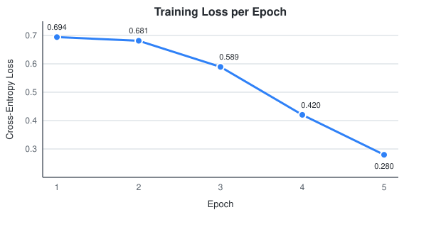

<div align="center">

# 🎬 IMDB Movie Review Sentiment Analysis with LSTM

**A deep learning model built from scratch in PyTorch that classifies movie reviews as _Positive_ or _Negative_.**

[](https://www.python.org/)
[](https://pytorch.org/)
[](https://pandas.pydata.org/)
[](https://colab.research.google.com/github/saksham802/sentialmal_analysis/blob/main/notebooks/Sentiment_Analysis_LSTM.ipynb)
[](LICENSE)

### 🎯 Test Accuracy: **83.72%**

</div>

---

## 📌 Overview

Sentiment analysis is a core **Natural Language Processing (NLP)** task with real-world uses in
product reviews, social media monitoring and customer feedback analysis.

In this project I built a complete NLP pipeline **without any high-level text libraries**. The
tokenizer, vocabulary, encoder and padding are all written by hand, followed by an **LSTM
(Long Short-Term Memory)** neural network in PyTorch that learns the sentiment of IMDB movie reviews.

### ✨ Highlights
- 🧹 **Custom text preprocessing:** lower-casing, punctuation removal, tokenization, de-duplication
- 📖 **Vocabulary built from scratch:** word → index mapping learned only from the training set (no data leakage)
- 📏 **Sequence padding/truncation** to a fixed length of 300 tokens
- 🧠 **LSTM model** with learned word embeddings and dropout regularisation
- 🔁 **Custom PyTorch `Dataset` + `DataLoader`** for mini-batch training
- 📈 **83.72% accuracy** on ~5,000 unseen test reviews after only 5 epochs

---

## 📂 Dataset

| Property | Details |
|---|---|
| **Source** | [IMDB Dataset (CSV) on Kaggle](https://www.kaggle.com/datasets/columbine/imdb-dataset-sentiment-analysis-in-csv-format) |
| **Task** | Binary classification: `0` = Negative, `1` = Positive |
| **Train / Valid / Test** | 40,000 / 5,000 / 5,000 reviews |
| **Cleaning** | No missing values; 277 + 5 + 2 duplicate reviews removed |

Kaggle downloads the dataset automatically through `kagglehub`, so you don't need to download anything by hand.

---

## 🏗️ Model Architecture

```
Input Review (text)
        │
        ▼
┌──────────────────────┐
│  Tokenize + Encode   │  "great movie!" → [512, 87]
│  Pad / Truncate (300)│  → [512, 87, 0, 0, ..., 0]
└──────────────────────┘
        │
        ▼
┌──────────────────────┐
│ Embedding (dim=128)  │  each word → dense 128-d vector
└──────────────────────┘
        │
        ▼
┌──────────────────────┐
│ LSTM (hidden=64)     │  reads the review word by word
└──────────────────────┘
        │  final hidden state
        ▼
┌──────────────────────┐
│ Dropout (p=0.3)      │  prevents overfitting
└──────────────────────┘
        │
        ▼
┌──────────────────────┐
│ Linear (64 → 2)      │  logits → Positive / Negative
└──────────────────────┘
```

| Hyperparameter | Value |
|---|---|
| Embedding dimension | 128 |
| LSTM hidden size | 64 |
| Max sequence length | 300 |
| Dropout | 0.3 |
| Loss function | CrossEntropyLoss |
| Optimizer | Adam (lr = 0.001) |
| Batch size | 32 |
| Epochs | 5 |

---

## 📊 Results

<div align="center">
  
</div>

| Epoch | Training Loss |
|:---:|:---:|
| 1 | 0.6943 |
| 2 | 0.6812 |
| 3 | 0.5892 |
| 4 | 0.4203 |
| 5 | **0.2796** |

> **Final Test Accuracy: 83.72%** on held-out test reviews.

The loss stays flat for the first two epochs while the embeddings are still random. Once the LSTM
starts picking up meaningful word patterns, the loss drops sharply, which is typical LSTM
training behaviour on long text sequences.

---

## 📁 Project Structure

```
sentialmal_analysis/
├── notebooks/
│   └── Sentiment_Analysis_LSTM.ipynb   # Original end-to-end experiment (with outputs)
├── src/
│   ├── preprocess.py                   # Tokenizer, vocabulary, encoding, padding
│   ├── dataset.py                      # PyTorch Dataset + CSV loading
│   ├── model.py                        # SentimentLSTM architecture
│   ├── train.py                        # Training + validation + test pipeline
│   └── predict.py                      # Predict sentiment of any custom review
├── assets/
│   └── training_loss.svg               # Training curve
├── requirements.txt
├── LICENSE
└── README.md
```

---

## 🚀 Getting Started

### 1. Clone the repository
```bash
git clone https://github.com/saksham802/sentialmal_analysis.git
cd sentialmal_analysis
```

### 2. Install dependencies
```bash
pip install -r requirements.txt
```

### 3. Train the model
```bash
python src/train.py --epochs 5 --batch-size 32
```
This downloads the dataset, trains the LSTM (using a GPU if one is available), reports validation and
test accuracy, and saves the model to `models/`.

### 4. Predict on your own review
```bash
python src/predict.py "This movie was an absolute masterpiece, the acting was brilliant!"
```
Example output:
```
Review     : This movie was an absolute masterpiece, the acting was brilliant!
Sentiment  : Positive
Confidence : <model probability>%
```

### ☁️ Or run it in the browser
Click the **Open in Colab** badge at the top to run the full notebook on a free GPU.

---

## 🧠 Key Learnings

- How raw text is turned into numbers a neural network can use (tokenization → indices → embeddings)
- Why sequences need **padding** for batched training, and the trade-off of truncating long reviews
- How an **LSTM** keeps context across a sequence and avoids the vanishing-gradient problem of vanilla RNNs
- How to pick the right loss function: `CrossEntropyLoss` for 2-logit output vs. `BCEWithLogitsLoss` for a single logit
- Writing clean training and evaluation loops with `model.train()` / `model.eval()` and `torch.no_grad()`

---

## 🔮 Future Improvements

- [ ] Use **pre-trained embeddings** (GloVe / Word2Vec) for better word representations
- [ ] Try a **Bidirectional / stacked LSTM** to read context in both directions
- [ ] Use `pack_padded_sequence` so the LSTM skips padding tokens
- [ ] Add early stopping based on validation accuracy
- [ ] Fine-tune a **Transformer** (BERT / DistilBERT) and compare it with the LSTM baseline
- [ ] Deploy as a web app with **Streamlit** or **Gradio**

---

## 👤 Author

**Saksham**

[](https://github.com/saksham802)

⭐ If you found this project useful, please consider giving it a star!
